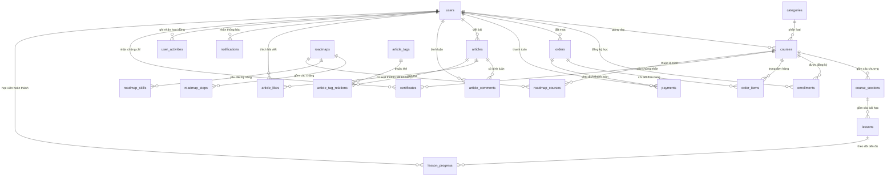

# TÀI LIỆU THIẾT KẾ CƠ SỞ DỮ LIỆU MYSQL (ĐỒ ÁN TỐT NGHIỆP)
**Hệ thống học lập trình trực tuyến (E-Learning Platform)**

Tài liệu này mô tả chi tiết kiến trúc CSDL quan hệ MySQL được chuẩn hóa theo dạng chuẩn 3 (3NF), ánh xạ 100% với các tính năng trên giao diện:
1. Xác thực & Quản lý người dùng (`/login`, `/register`, `/profile`)
2. Khóa học, Chương học & Bài học (Trang chủ & Danh mục)
3. Lộ trình nghề nghiệp (`/lo-trinh`)
4. Đăng ký & Tiến độ học tập (`/khoa-hoc-cua-toi`)
5. Đơn hàng & Thanh toán (`/my-orders`, `/payment-history`)
6. Bảng tin cộng đồng (`/bang-tin`)
7. Thông báo & Nhật ký hoạt động (`/activities`)

---

## 1. Sơ đồ quan hệ thực thể (ERD - Entity Relationship Diagram)



---

## 2. Danh mục 22 bảng trong CSDL

| STT | Tên bảng | Chức năng trên giao diện |
|:---:|:---|:---|
| 1 | `users` | Tài khoản học viên, giảng viên, admin, thông tin cá nhân |
| 2 | `categories` | Danh mục phân loại khóa học (Front-end, Back-end...) |
| 3 | `courses` | Danh sách khóa học, giá bán, thời lượng, số học viên |
| 4 | `course_sections` | Các chương học trong từng khóa |
| 5 | `lessons` | Từng bài học, video bài giảng, thời lượng |
| 6 | `roadmaps` | Lộ trình nghề nghiệp: Front-end, Back-end, Fullstack, DevOps |
| 7 | `roadmap_steps` | Các chặng học trong lộ trình (Chặng 1, 2, 3...) |
| 8 | `roadmap_skills` | Danh sách kỹ năng cần tích lũy trong lộ trình |
| 9 | `roadmap_courses` | Bảng liên kết khóa học thuộc lộ trình |
| 10 | `enrollments` | Khóa học người dùng đang học (Trang Khóa học của tôi) |
| 11 | `lesson_progress` | Đánh dấu bài học nào đã hoàn thành |
| 12 | `certificates` | Chứng chỉ hoàn thành khóa học |
| 13 | `orders` | Đơn hàng mua khóa học (Trang Đơn hàng của tôi) |
| 14 | `order_items` | Khóa học chi tiết trong từng đơn hàng |
| 15 | `payments` | Lịch sử giao dịch thanh toán (Trang Lịch sử thanh toán) |
| 16 | `articles` | Bài viết chia sẻ trên trang Bảng tin |
| 17 | `article_tags` | Thẻ tag bài viết (#React.js, #Node.js...) |
| 18 | `article_tag_relations` | Liên kết bài viết và các thẻ |
| 19 | `article_comments` | Bình luận dưới bài viết |
| 20 | `article_likes` | Lượt thích bài viết |
| 21 | `notifications` | Thông báo gửi tới học viên (Icon Chuông thông báo) |
| 22 | `user_activities` | Nhật ký hoạt động học tập (Trang Hoạt động) |

---

## 3. Hướng dẫn Import vào MySQL

### Cách 1: Sử dụng MySQL Command Line
```bash
mysql -u root -p < database/schema.sql
```

### Cách 2: Sử dụng phpMyAdmin / MySQL Workbench / DBeaver / Navicat
1. Mở phần mềm quản lý CSDL (như phpMyAdmin hoặc MySQL Workbench).
2. Tạo mới một query tab hoặc chọn tab **Import**.
3. Mở file [database/schema.sql](file:///x:/DATN/database/schema.sql), sao chép toàn bộ nội dung và ấn **Run / Execute**.
4. Toàn bộ 22 bảng kèm dữ liệu mẫu sẽ được tạo tự động với charset chuẩn `utf8mb4_unicode_ci` (hỗ trợ đầy đủ tiếng Việt).
