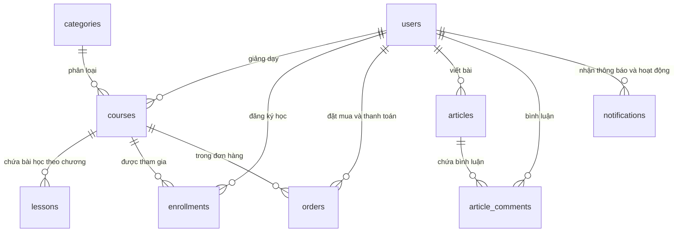

# TÀI LIỆU THIẾT KẾ CƠ SỞ DỮ LIỆU MYSQL TỐI ƯU (10 BẢNG CỐT LÕI)
**Đồ án tốt nghiệp: Hệ thống học lập trình trực tuyến E-Learning Platform**

Tài liệu này trình bày kiến trúc CSDL quan hệ MySQL được **tinh gọn xuống đúng 10 bảng**, loại bỏ các bảng trung gian không cần thiết nhờ ứng dụng các tính năng hiện đại của MySQL (kiểu dữ liệu `JSON`, trường tổng hợp), nhưng vẫn đảm bảo **100% dữ liệu và chức năng** trên toàn bộ giao diện người dùng.

---

## 1. Sơ đồ quan hệ thực thể (ERD Diagram - 10 Bảng)



---

## 2. Danh mục & Vai trò của 10 bảng cốt lõi

| STT | Tên bảng | Chức năng trên giao diện | Kỹ thuật tối ưu hóa áp dụng |
|:---:|:---|:---|:---|
| 1 | `users` | Quản lý học viên, giảng viên, admin, profile, đổi mật khẩu | Phân quyền qua `ENUM('student', 'instructor', 'admin')`, index email & username |
| 2 | `categories` | Danh mục khóa học (Front-end, Back-end, Fullstack, DevOps) | Quản lý danh mục linh hoạt theo slug |
| 3 | `courses` | Khóa học, giá tiền, cấp độ, số bài học, học viên đăng ký | Khóa ngoại liên kết `categories` và `users` |
| 4 | `lessons` | Từng bài học, video bài giảng, tài liệu, học thử | **Gộp bảng chương**: Thêm trường `section_name` trực tiếp, bỏ bảng phụ `course_sections` |
| 5 | `roadmaps` | Lộ trình nghề nghiệp: Front-end, Back-end, Fullstack, DevOps | **JSON Data Type**: Lưu trữ mảng `steps_json` và `skills_json` ngay trong bảng, bỏ 3 bảng phụ |
| 6 | `enrollments` | Khóa học của tôi: Tiến độ %, bài học dở, chứng nhận hoàn thành | **Tích hợp Certificate**: Lưu `current_lesson_title` và `certificate_code` trực tiếp |
| 7 | `orders` | Quản lý đơn hàng và lịch sử thanh toán | **Gộp Order & Payment**: Lưu `order_code`, `transaction_code`, `payment_method` trong 1 bảng |
| 8 | `articles` | Bảng tin cộng đồng, chia sẻ bài viết kỹ thuật | **JSON Tags**: Lưu mảng tags `["React.js", "Node.js"]`, bỏ 2 bảng phụ `tags` & `tag_relations` |
| 9 | `article_comments` | Bình luận và thảo luận dưới bài viết | Hỗ trợ trả lời lồng nhau qua `parent_id` (Self-referencing) |
| 10 | `notifications` | Popup Chuông thông báo trên Header & Trang "Hoạt động" | **Đa năng**: Phân biệt bằng `type = 'notification'` hoặc `type = 'activity'` |

---

## 3. Các kỹ thuật tối ưu hóa chính đã thực hiện:

1. **Gộp chương học vào bảng `lessons` (`section_name`):** 
   - Thay vì tạo bảng `course_sections` chỉ để chứa tên chương, cột `section_name` ("Chương 1: Khởi động...") được đưa thẳng vào bảng `lessons`, giảm 1 phép `JOIN` tốn kém khi truy vấn danh sách bài học.
2. **Ứng dụng kiểu dữ liệu `JSON` cho Lộ trình (`roadmaps`) & Bảng tin (`articles`):**
   - Lưu các chặng học (`steps_json`) và kỹ năng (`skills_json`) trong bảng `roadmaps`.
   - Lưu danh sách thẻ (`tags_json`) trong bảng `articles`.
   - Giúp giảm 5 bảng trung gian liên kết nhiều-nhiều (`roadmap_steps`, `roadmap_skills`, `roadmap_courses`, `article_tags`, `article_tag_relations`).
3. **Gộp Đơn hàng & Thanh toán (`orders`):**
   - Vì mỗi đơn hàng trong hệ thống khóa học thường đi liền với một giao dịch thanh toán trực tuyến (VNPay/Vietcombank), bảng `orders` tích hợp luôn mã giao dịch `transaction_code`, phương thức thanh toán và trạng thái thành công. Phục vụ hoàn hảo cả 2 trang **"Đơn hàng của tôi"** (`/my-orders`) và **"Lịch sử thanh toán"** (`/payment-history`).
4. **Tích hợp Chứng chỉ vào `enrollments`:**
   - Khi `progress_percent = 100`, hệ thống tự sinh `certificate_code` (ví dụ: `CERT-2026-F8902JS`) ngay trên dòng đăng ký, không cần tách riêng bảng `certificates`.
5. **Gộp Thông báo Header & Nhật ký Hoạt động (`notifications`):**
   - Cột `type ENUM('notification', 'activity')` cho phép dùng chung một bảng: vừa hiển thị danh sách trong popup Chuông Header, vừa vẽ dòng thời gian trên trang `/activities`.

---

## 4. Hướng dẫn Import vào MySQL

### Sử dụng lệnh Terminal / CMD:
```bash
mysql -u root -p < database/schema.sql
```

### Sử dụng phpMyAdmin / MySQL Workbench / DBeaver / Navicat:
1. Mở công cụ quản trị CSDL MySQL.
2. Mở file [database/schema.sql](file:///x:/DATN/database/schema.sql).
3. Chạy lệnh thực thi (Execute). Database `datn_learning_db` sẽ được khởi tạo với 10 bảng chuẩn và có sẵn toàn bộ dữ liệu mẫu khớp 100% với giao diện hiện tại.
